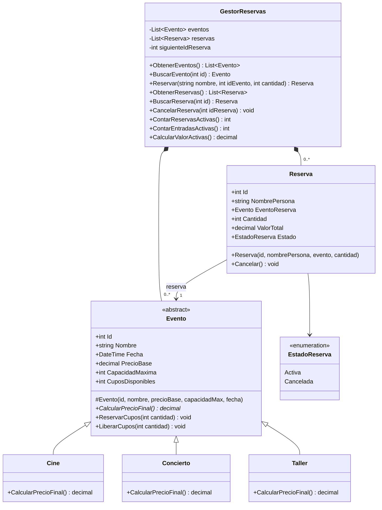
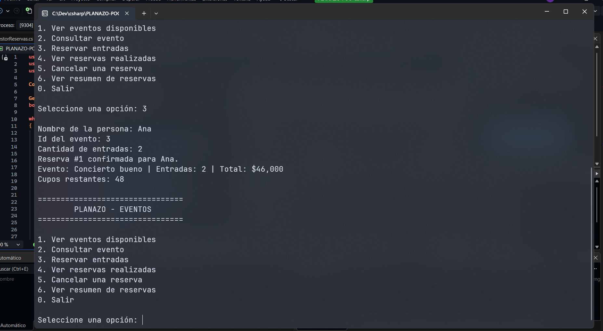
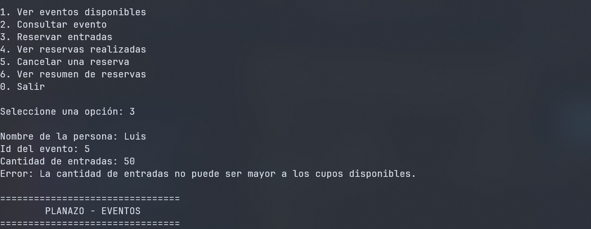
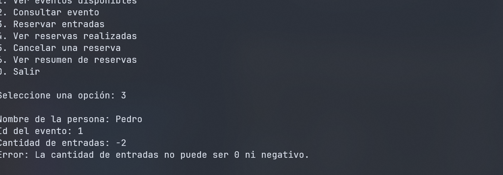
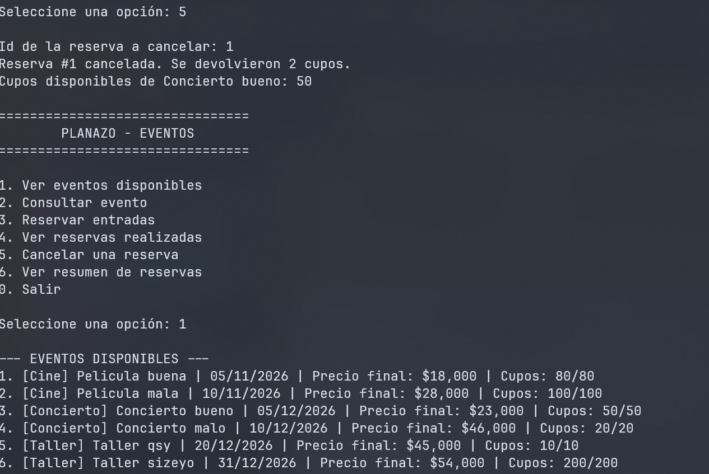
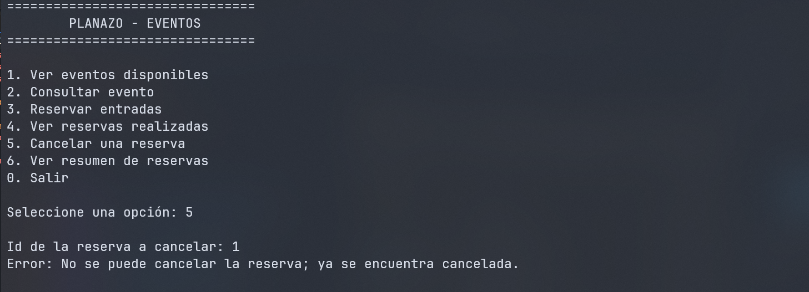
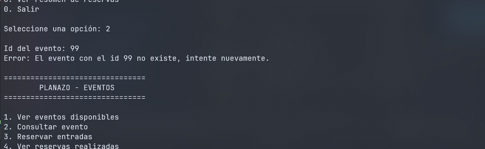
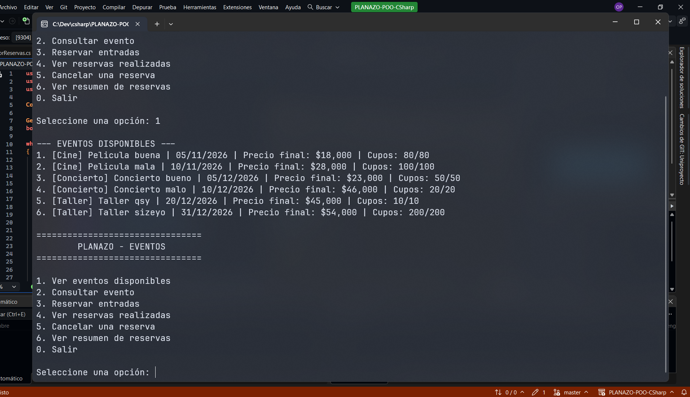
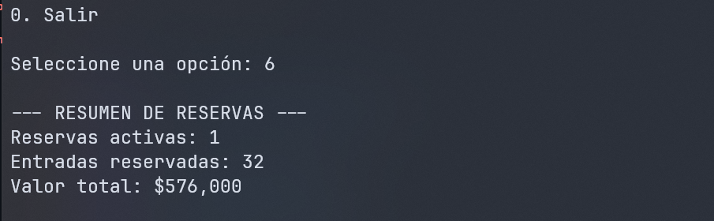

# PLANAZO-POO-CSharp

Aplicación de consola en C# y .NET para la empresa PLANAZO, que organiza conciertos, funciones de cine y talleres. Permite consultar eventos, reservar entradas, controlar los cupos disponibles y cancelar reservas, aplicando los principios de Programación Orientada a Objetos.

## Funcionalidades

1. **Ver eventos disponibles:** lista los eventos con su tipo, fecha, precio final y cupos.
2. **Consultar evento:** muestra el detalle de un evento por su Id.
3. **Reservar entradas:** crea una reserva validando la cantidad y los cupos disponibles.
4. **Ver reservas realizadas:** lista todas las reservas con su estado (Activa o Cancelada).
5. **Cancelar una reserva:** cambia el estado a Cancelada y devuelve los cupos al evento.
6. **Ver resumen de reservas:** cantidad de reservas activas, entradas reservadas y valor total de las reservas activas.

El programa inicia con seis eventos: dos películas, dos conciertos y dos talleres. Ninguna operación incorrecta cierra el programa: los errores se muestran como mensajes y el menú continúa.

## Cómo ejecutar

Requisitos: [.NET 10 SDK](https://dotnet.microsoft.com/download).

```bash
git clone https://github.com/AlXstorCode/PLANAZO-POO-CSharp.git
cd PLANAZO-POO-CSharp/PLANAZO-POO-CSharp
dotnet run
```

## Estructura del proyecto

```text
PLANAZO-POO-CSharp/
├── PLANAZO-POO-CSharp.slnx
├── README.md
├── Capturas/
└── PLANAZO-POO-CSharp/
    ├── Program.cs              Menú interactivo
    ├── Modelos/
    │   ├── Evento.cs           Clase abstracta
    │   ├── Cine.cs
    │   ├── Concierto.cs
    │   ├── Taller.cs
    │   ├── Reserva.cs
    │   └── EstadoReserva.cs    Enum Activa / Cancelada
    └── Servicios/
        └── GestorReservas.cs   Listas y lógica de reservas
```

## Clases y relaciones

| Clase | Responsabilidad |
|---|---|
| `Evento` | Clase abstracta con los datos comunes: Id, nombre, fecha, precio base, capacidad máxima y cupos disponibles. Protege sus cupos con `ReservarCupos` y `LiberarCupos`. |
| `Cine` | Hereda de `Evento`. Mantiene el precio base. |
| `Concierto` | Hereda de `Evento`. Aumenta el precio base un 15 %. |
| `Taller` | Hereda de `Evento`. Aplica un descuento del 10 %. |
| `Reserva` | Asocia una persona con un evento. Guarda la cantidad de entradas, el valor total y su estado. Impide ser cancelada dos veces. |
| `EstadoReserva` | Enum con los valores `Activa` y `Cancelada`. |
| `GestorReservas` | Contiene la lista de eventos y la lista de reservas. Busca, reserva, cancela y calcula el resumen. |
| `Program` | Muestra el menú, lee los datos del usuario y captura las excepciones. |

**Cómo se relacionan:**

- `Cine`, `Concierto` y `Taller` **heredan** de `Evento`.
- `Reserva` está **asociada** a un `Evento`: guarda una referencia al objeto evento (`EventoReserva`), no solo su nombre. Así puede pedirle su precio final al crearse.
- `GestorReservas` está **compuesto** por dos `List<T>`: `List<Evento>` y `List<Reserva>`. Las listas nacen con el gestor y son `private readonly`, así que nadie de afuera puede reemplazarlas.
- `Program` usa un único `GestorReservas` y nunca modifica eventos ni reservas directamente.

## Diagrama de clases UML



## Conceptos de Programación Orientada a Objetos

### Encapsulamiento

Los datos se protegen para que solo se modifiquen de forma controlada.

- En `Evento`, `CuposDisponibles` es `{ get; private set; }`. Desde afuera solo se lee. La única forma de cambiarlo es con `ReservarCupos` y `LiberarCupos`, que validan antes de modificar:

```csharp
public int CuposDisponibles { get; private set; }

public void ReservarCupos(int cantidad)
{
    if (cantidad <= 0)
        throw new ArgumentException("La cantidad de entradas no puede ser 0 ni negativo.");
    if (cantidad > CuposDisponibles)
        throw new InvalidOperationException("La cantidad de entradas no puede ser mayor a los cupos disponibles.");

    CuposDisponibles -= cantidad;
}
```

- `Id`, `Nombre`, `Fecha`, `PrecioBase` y `CapacidadMaxima` solo tienen `get`. Se asignan en el constructor y no cambian nunca.
- En `Reserva`, `Estado` es `{ get; private set; }`. Solo cambia mediante `Cancelar()`.
- En `GestorReservas`, las listas son `private readonly`.

### Abstracción

`Evento` es una clase `abstract`: representa la idea general de un evento y no se puede crear con `new Evento(...)`. Su constructor es `protected`, así que solo las clases hijas lo usan. Declara `CalcularPrecioFinal()` sin cuerpo, dejando que cada tipo decida su regla:

```csharp
public abstract class Evento
{
    public abstract decimal CalcularPrecioFinal();
}
```

### Herencia

`Cine`, `Concierto` y `Taller` heredan de `Evento`. Reciben todas sus propiedades y los métodos de cupos sin repetirlos, y pasan los datos al constructor del padre con `base`:

```csharp
public class Concierto : Evento
{
    public Concierto(int id, string nombre, decimal preciobase, int capacidadmax, DateTime fecha)
        : base(id, nombre, preciobase, capacidadmax, fecha)
    {
    }
}
```

### Polimorfismo

Cada clase hija sobrescribe `CalcularPrecioFinal()` con `override`:

| Clase | Regla | Precio base $50.000 |
|---|---|---|
| `Cine` | `return PrecioBase;` | $50.000 |
| `Concierto` | `return PrecioBase * 1.15m;` | $57.500 |
| `Taller` | `return PrecioBase * 0.9m;` | $45.000 |

El gestor guarda todos los eventos en una sola `List<Evento>`. Al recorrerla, se llama al mismo método en todos y cada objeto responde con su propia regla:

```csharp
foreach (Evento e in gestor.ObtenerEventos())
{
    Console.WriteLine(e.CalcularPrecioFinal());
}
```

`Reserva` también aprovecha el polimorfismo: calcula `evento.CalcularPrecioFinal() * cantidad` sin saber qué tipo de evento es.

### Colecciones

`GestorReservas` usa `List<Evento>` y `List<Reserva>` para almacenar la información, y las recorre con `foreach` para buscar y calcular el resumen.

### Excepciones

Las reglas de negocio lanzan excepciones y `Program` las captura con `try/catch`, mostrando el mensaje sin cerrar el programa:

| Situación | Excepción | Dónde se lanza |
|---|---|---|
| Cantidad cero o negativa | `ArgumentException` | `Evento.ReservarCupos` |
| Más entradas que cupos | `InvalidOperationException` | `Evento.ReservarCupos` |
| Cancelar una reserva ya cancelada | `InvalidOperationException` | `Reserva.Cancelar` |
| Evento o reserva inexistente | `KeyNotFoundException` | `GestorReservas.BuscarEvento` / `BuscarReserva` |
| Nombre vacío | `ArgumentException` | `GestorReservas.Reservar` |
| Texto en lugar de número | `FormatException` | `int.Parse` en `Program` |

Todos los valores monetarios usan `decimal`.

## Casos de prueba

### 1. Registrar una reserva válida



### 2. Reservar más entradas que los cupos disponibles



### 3. Reservar con una cantidad negativa



### 4. Cancelar una reserva y comprobar que se devuelven los cupos



### 5. Cancelar dos veces la misma reserva



### 6. Consultar un evento inexistente



### 7. Precio final según el tipo de evento



### Resumen de reservas



## Pregunta de sustentación

**¿Por qué utilizaste una clase abstracta `Evento` en lugar de crear clases completamente independientes para Cine, Concierto y Taller? ¿Qué ventajas tiene esta decisión cuando necesitamos agregar un nuevo tipo de evento?**

Porque los tres tipos comparten casi todo: Id, nombre, fecha, precio base, capacidad, cupos y las reglas para reservar y liberar cupos. Lo único que cambia entre ellos es cómo se calcula el precio final. Con clases independientes habría que repetir esas seis propiedades y los métodos `ReservarCupos` y `LiberarCupos` tres veces, y cualquier corrección en la validación de cupos habría que hacerla en tres lugares.

Con `Evento` abstracta, esa lógica se escribe una sola vez. Cada hija solo define lo que la hace distinta, como `Concierto`, que solo contiene su constructor y `return PrecioBase * 1.15m;`.

Además, `Evento` no puede instanciarse, porque un "evento genérico" no tiene sentido en PLANAZO, y obliga mediante `abstract decimal CalcularPrecioFinal()` a que todo tipo nuevo implemente su propio precio. Si se olvida, el programa no compila.

**Ventajas al agregar un nuevo tipo de evento**, por ejemplo un `Festival`:

1. Se crea una sola clase `Festival : Evento` con su constructor y su `override` de `CalcularPrecioFinal()`.
2. No hay que modificar `Cine`, `Concierto` ni `Taller`.
3. `GestorReservas`, `Reserva` y el menú funcionan sin cambios, porque trabajan con el tipo `Evento` y no con cada clase concreta. Por ejemplo, `Reserva` calcula `evento.CalcularPrecioFinal() * cantidad` y `GestorReservas` guarda todo en `List<Evento>`. Solo habría que agregar el festival a la lista inicial con `eventos.Add(new Festival(...))`.
